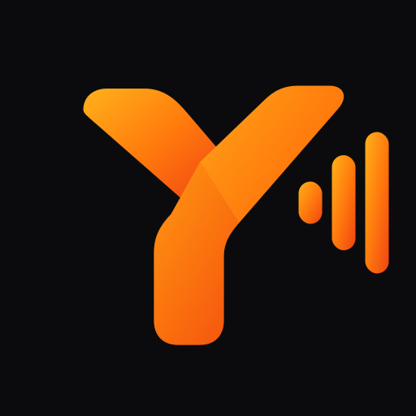

> Drafted with AI assistance and reviewed by Dean.

{: width="160" }

[Last time](/blog/local-dictation-mac-parakeet-ollama/) I got local dictation working on my Mac and ended by saying the iPhone was next, where keyboards aren't allowed to touch the microphone. It didn't take the weekend. With Claude Code doing the building, it took an evening.

The result is **Yabber**: a keyboard with a mic button that works in any app, with transcription running on the phone's Neural Engine. Nothing goes to the cloud.

## The catch with keyboards

iOS keyboards run as extensions with tight memory limits, and they can't use the microphone at all. So the work has to be split:

```
Keyboard mic button → signal the Yabber app → app records and runs Parakeet → text back to the keyboard → inserted
```

- **The app** holds the microphone and runs [Parakeet TDT v3](https://huggingface.co/nvidia/parakeet-tdt-0.6b-v3) through [FluidAudio](https://github.com/FluidInference/FluidAudio), a Swift library that runs it on the Neural Engine with Core ML.
- **The keyboard** just has buttons. It tells the app to start and stop, and inserts whatever comes back.
- **They talk** through a shared App Group folder, with Darwin notifications as the doorbell.

The first time you tap the mic, the keyboard has to open the Yabber app to start a session, and you swipe back to where you were. After that the app stays running in the background, so later taps record straight away without leaving your app. As far as I can tell, Wispr Flow works the same way on iPhone.

## Testing the risky bit first

The whole design depends on one question: will iOS let an app sit in the background and run a speech model? So before building anything real, Claude built a throwaway probe app to find out. It benchmarked Parakeet in the foreground, then again after I'd gone back to the home screen, while also transcribing the live mic.

On my iPhone 17 Pro (iOS 26.7.2), it worked:

| | Neural Engine | CPU |
|---|---|---|
| 3.4 s clip, backgrounded | 53–72 ms | 111–120 ms |
| 20.6 s clip, backgrounded | 185–263 ms | 285–291 ms |
| Model load | 0.13 s | 3.8 s |
| Peak memory | 70 MB | 88 MB |

Both got every word right on the test clips. The Neural Engine is about twice as fast, and the CPU is a decent fallback.

The probe also found the catch. iOS only keeps an app alive in the background while its audio is running. When the probe paused the mic, the app was suspended within seconds, and a suspended app isn't allowed to start the mic again.

## So the mic stays on

That shapes how a session works:

- **During a session**, the mic stays on and the orange dot shows. Between dictations, Yabber keeps only the last 0.4 seconds of audio in memory, so your first word isn't clipped when you tap. Nothing is transcribed or saved until you tap.
- **After 5 minutes** without a dictation, it turns the mic off. That's adjustable from 1 to 30 minutes.
- **The next tap after that** opens the app again to start a new session.

In real use, short dictations come back in 60–80 milliseconds, which feels instant.

## Things that bit

- **There's no way back.** Since iOS 26.4 the little "◀ Notes" arrow no longer appears when a keyboard opens its app, and Apple has [confirmed](https://developer.apple.com/forums/thread/826851) there's no API to send you back. Swiping right along the bottom edge always works, so the app shows an animation of exactly that.
- **Opening the app at all is a workaround.** Keyboards aren't really meant to open apps. Walking up to `UIApplication` through the responder chain works, and Apple's own developer support [suggests it](https://developer.apple.com/forums/thread/812091), but it isn't officially supported and could break in a future iOS release.
- **Full Access is required.** Without it the keyboard can't reach the shared folder or open the app.
- **iOS 27 is a worry.** There are reports that background Neural Engine inference broke in the first beta. Yabber falls back to the CPU if that happens, but I haven't tried it there yet.

## Should I have checked the App Store first?

Probably. Afterwards I found [SpeakUp](https://getspeakup.app/ios/) and [Spokenly](https://spokenly.app/dictation-for-iphone), which both run Parakeet locally on iPhone for free. If you just want this, try those.

I'm still glad I built my own. It has no recording cap (SpeakUp stops at 60 seconds), nothing depends on someone's free tier lasting, and I can change anything. With a paid developer account the install also lasts a year, not the 7 days a free account gets.

## The name

It started as "WisprFree", which is a terrible name to keep. My first pick, Sotto (from *sotto voce*), turned out to be shared by about 35 apps on the App Store, including a dictation app. So I went Australian: **yabber** is slang for a chat, and no app on the Australian App Store was using it when I checked.

## App Store?

Not for now. Apple's keyboard rules say keyboards must offer real typing and must work without Full Access, so Yabber would need a full QWERTY layout before review. There's also a privacy policy, licence credits for Parakeet and FluidAudio, and the usual App Store Connect forms. I've written the full list up in the repo in case I get the urge.

The code is on GitHub at [deanbaker/yabber](https://github.com/deanbaker/yabber).
